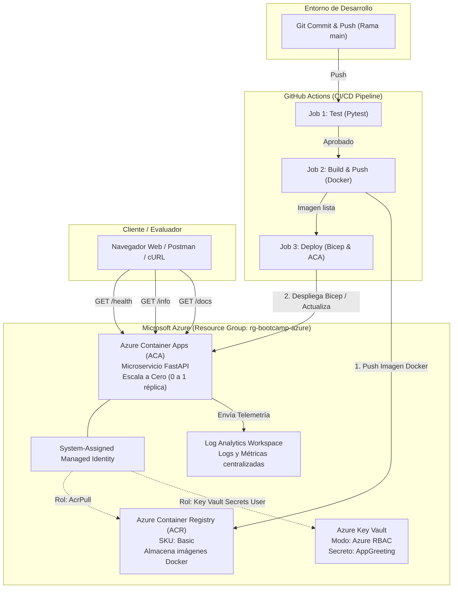

# Cloud Health & Echo Service
> **Proyecto Final**  
> Microservicio Serverless seguro, automatizado con CI/CD y diseñado para consumo de costo cero en suscripciones estudiantiles.

---

##Tabla de Contenidos
1. [Descripción del Proyecto](#-descripción-del-proyecto)
2. [Arquitectura de la Solución](#-arquitectura-de-la-solución)
3. [Estructura del Repositorio](#-estructura-del-repositorio)
4. [Estrategia de Optimización de Costos](#-estrategia-de-optimización-de-costos)
5. [Prerrequisitos](#-prerrequisitos)
6. [Guía de Despliegue Paso a Paso](#-guía-de-despliegue-paso-a-paso)
7. [Configuración de CI/CD en GitHub Actions](#-configuración-de-cicd-en-github-actions)
8. [Pruebas Locales (Sin Azure)](#-pruebas-locales-sin-azure)
9. [Verificación de Endpoints en Producción](#-verificación-de-endpoints-en-producción)
10. [Evidencias de Entrega (Capturas de Pantalla)](#-evidencias-de-entrega-capturas-de-pantalla)
11. [Limpieza de Recursos (Clean-Up)](#-limpieza-de-recursos-clean-up)

---

## Descripción del Proyecto

**Cloud Health & Echo Service** es un microservicio desarrollado en **Python 3.11 con FastAPI**, empaquetado en contenedores **Docker** y desplegado sobre una arquitectura en la nube de **Microsoft Azure**.

El proyecto resuelve los siguientes requerimientos:
- **Salud del Sistema (`/health`):** Endpoint de monitoreo que valida el estado operativo del microservicio y el entorno (`production`).
- **Seguridad y Cero Secretos Quemados (`/info`):** Lee un secreto almacenado en **Azure Key Vault** mediante **Identidad Administrada (Managed Identity)** y **Azure RBAC**, inyectándolo como variable de entorno sin exponer credenciales en el código ni en el repositorio.
- **Calidad de Código:** Suite completa de pruebas unitarias automatizadas con **Pytest**.
- **Infraestructura como Código (IaC):** Aprovisionamiento reproducible y modular mediante plantillas **Azure Bicep**.
- **DevOps y Automatización:** Pipeline de integración y despliegue continuo (**CI/CD**) en **GitHub Actions** con 3 etapas: *Test*, *Build & Push* y *Deploy*.

---

## Arquitectura de la Solución



### Componentes Clave:
1. **Azure Container Registry (ACR):** Repositorio privado donde se guardan las imágenes Docker versionadas por commit hash (`SHA`).
2. **Azure Key Vault:** Bóveda de seguridad con control de acceso basado en roles (**Azure RBAC**). Contiene el secreto `AppGreeting`.
3. **Azure Container Apps (ACA):** Servicio de contenedores Serverless. Cuenta con una **Identidad Administrada por el Sistema** que tiene permisos `Key Vault Secrets User` en Key Vault y `AcrPull` en ACR.
4. **Log Analytics Workspace:** Repositorio central de registros y métricas operativas de la Container App.

---

## Estructura del Repositorio

```text
Proyect/
├── .github/
│   └── workflows/
│       └── deploy.yml          # Pipeline de CI/CD automatizado (3 jobs)
├── infra/
│   └── main.bicep              # Infraestructura como Código (ACR, Key Vault, ACA, RBAC)
├── src/
│   ├── app.py                  # Código fuente del microservicio FastAPI
│   ├── Dockerfile              # Definición del contenedor en Python 3.11-slim
│   ├── requirements.txt        # Dependencias de producción y pruebas
│   └── test_app.py             # Pruebas unitarias automatizadas con Pytest
└── README.md                   # Documentación técnica y evidencias de entrega
```

---

## Estrategia de Optimización de Costos

Para evitar el consumo de créditos en suscripciones de **Azure for Students** o cuentas gratuitas:

1. **Escala a Cero (`minReplicas: 0`):** Cuando no hay peticiones HTTP activas, la cantidad de réplicas baja a **0**. En este estado, el consumo de cómputo es de **\$0.00 USD**.
2. **Dimensionamiento Mínimo (`0.25 vCPU` y `0.5 GiB RAM`):** Cada petición que despierta el servicio consume los recursos mínimos posibles, quedando cubierta por la cuota gratuita mensual de Azure Container Apps.
3. **Azure Container Registry (SKU Basic):** El nivel básico proporciona almacenamiento privado al costo más bajo disponible.
4. **Azure Key Vault (SKU Standard):** Operaciones criptográficas de bajo volumen.
5. **Log Analytics con Retención de 30 Días:** Evita costos de almacenamiento prolongado.

---

## Prerrequisitos

- Una cuenta de **Microsoft Azure** (Suscripción Estudiantil, Free Trial o Pay-As-You-Go).
- Una cuenta de **GitHub**.
- **Azure CLI** (Opcional si usas Azure Cloud Shell desde el navegador).
- **Git**.

---

## Guía de Despliegue Paso a Paso

### Paso 1: Iniciar sesión en Azure
```bash
az login
```
Para seleccionar una suscripción en específico:
```bash
az account list --output table
az account set --subscription "<NOMBRE_O_ID_DE_TU_SUSCRIPCION>"
```

### Paso 2: Crear el Grupo de Recursos
```bash
az group create --name rg-bootcamp-azure --location eastus2
```

### Paso 3: Crear el Service Principal para GitHub Actions
```bash
SUBSCRIPTION_ID=$(az account show --query id -o tsv)

az ad sp create-for-rbac \
  --name "sp-github-actions-bootcamp" \
  --role contributor \
  --scopes /subscriptions/$SUBSCRIPTION_ID/resourceGroups/rg-bootcamp-azure \
  --json-auth
```

Copia el bloque JSON resultante:
```json
{
  "clientId": "xxxx-xxxx-xxxx-xxxx",
  "clientSecret": "xxxxxxxxxxxxxxxxxxxxxxxx",
  "subscriptionId": "xxxx-xxxx-xxxx-xxxx",
  "tenantId": "xxxx-xxxx-xxxx-xxxx"
}
```

Asigna permisos para que el Service Principal pueda otorgar los roles RBAC de la Container App (`Key Vault Secrets User` y `AcrPull`):
```bash
SP_APP_ID=$(az ad sp list --display-name "sp-github-actions-bootcamp" --query "[0].appId" -o tsv)

az role assignment create \
  --assignee $SP_APP_ID \
  --role "Role Based Access Control Administrator" \
  --scope /subscriptions/$SUBSCRIPTION_ID/resourceGroups/rg-bootcamp-azure
```

### Paso 4: Despliegue Inicial de Infraestructura con Bicep
```bash
az deployment group create \
  --resource-group rg-bootcamp-azure \
  --template-file infra/main.bicep
```

---

## Configuración de CI/CD en GitHub Actions

1. Ve a tu repositorio en **GitHub**.
2. Dirígete a **Settings** > **Secrets and variables** > **Actions**.
3. Haz clic en **New repository secret**.
4. Agrega el secreto:
   - **Name:** `AZURE_CREDENTIALS`
   - **Secret:** Pega el bloque JSON obtenido en el Paso 3.
5. Haz clic en **Add secret**.

A partir de este momento, cada `push` a la rama `main` ejecutará el pipeline completo.

---

## Pruebas Locales (Sin Azure)

### 1. Pruebas Unitarias con Pytest:
```bash
cd Proyect
python -m venv .venv

# Windows
.venv\Scripts\activate
# Linux / macOS
source .venv/bin/activate

pip install -r src/requirements.txt
pytest src/test_app.py -v
```

### 2. Ejecutar el Microservicio:
```bash
cd src
python app.py
```
Abre en tu navegador:
- `http://localhost:8000/health`
- `http://localhost:8000/info`
- `http://localhost:8000/docs`

---

## Verificación de Endpoints en Producción

Obtén la URL pública de la aplicación:
```bash
az containerapp show \
  --name ca-cloud-health \
  --resource-group rg-bootcamp-azure \
  --query "properties.configuration.ingress.fqdn" -o tsv
```

### 1. Verificación de Salud (`GET /health`)
```bash
curl -i https://<TU_URL_PUBLICA>/health
```
Respuesta:
```json
{
  "status": "ok",
  "environment": "production"
}
```

### 2. Verificación de Secreto Seguro (`GET /info`)
```bash
curl -i https://<TU_URL_PUBLICA>/info
```
Respuesta:
```json
{
  "service": "Cloud Health & Echo Service",
  "message": "Hola desde Azure Key Vault",
  "status": "active",
  "environment": "production"
}
```

---

## Evidencias de Entrega (Capturas de Pantalla)

### Evidencia 1: Recursos Desplegados en el Portal de Azure


---

### Evidencia 2: Ejecución Exitosa del Pipeline en GitHub Actions


---

### Evidencia 3: Respuesta del Endpoint `/health` y `/info`


---

## Limpieza de Recursos (Clean-Up)

```bash
az group delete --name rg-bootcamp-azure --yes --no-wait
```
