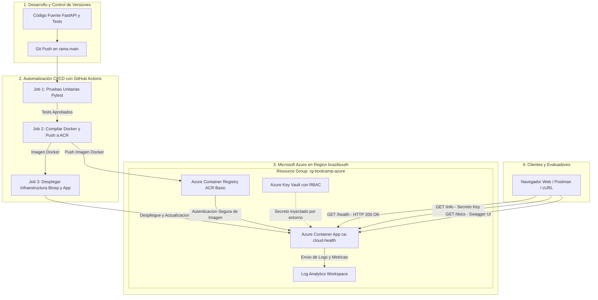
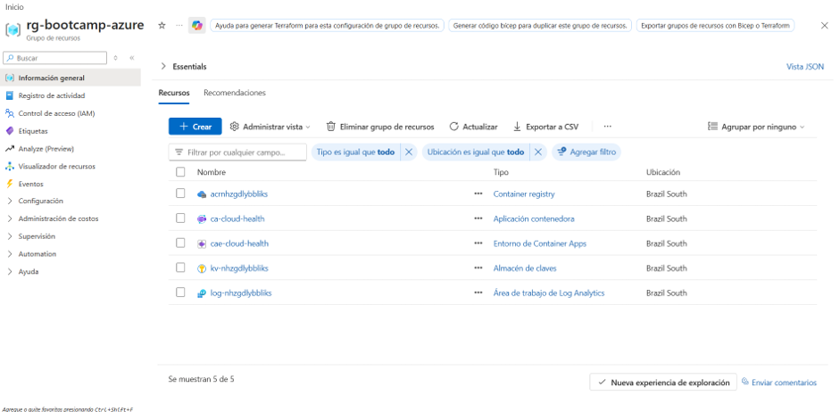
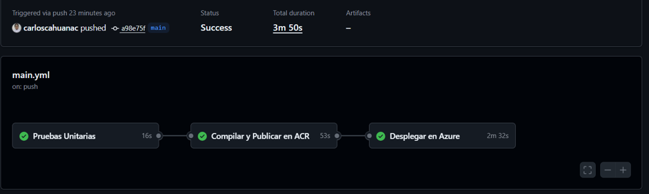
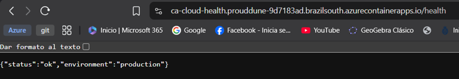
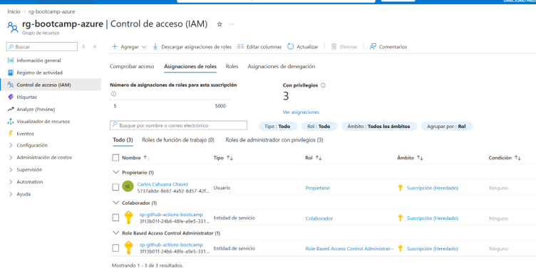

# Cloud Health & Echo Service

[](https://github.com/carloscahuanac/Proyecto-Azure/actions/workflows/main.yml)

> **Proyecto Final - Bootcamp de Arquitectura Cloud & DevOps en Microsoft Azure**  
> Microservicio Serverless seguro en Python FastAPI, empaquetado en Docker, aprovisionado mediante Infrastructure as Code (Bicep) y automatizado con CI/CD en GitHub Actions. Diseñado con escala a cero réplicas para consumo de costo cero en suscripciones estudiantiles.

---

## URLs Públicas del Servicio en Producción

La aplicación se encuentra desplegada y operativa en **Azure Container Apps** (Región: `brazilsouth`):

| Endpoint | Tipo | Descripción | Enlace Directo |
| :--- | :--- | :--- | :--- |
| **`/health`** | `GET` | Health Check (Estado del servicio y ambiente de ejecución) | [Abrir /health](https://ca-cloud-health.prouddune-9d7183ad.brazilsouth.azurecontainerapps.io/health) |
| **`/info`** | `GET` | Lectura segura del secreto inyectado desde Azure Key Vault | [Abrir /info](https://ca-cloud-health.prouddune-9d7183ad.brazilsouth.azurecontainerapps.io/info) |
| **`/docs`** | `GET` | Documentación interactiva Swagger UI / OpenAPI 3.1 | [Abrir /docs](https://ca-cloud-health.prouddune-9d7183ad.brazilsouth.azurecontainerapps.io/docs) |

> *Nota de Arquitectura:* Debido a la configuración de escala a cero (`minReplicas: 0`) para ahorro de créditos, si el servicio no ha recibido tráfico reciente, la primera petición puede demorar entre 8 y 12 segundos en responder mientras Azure aprovisiona la réplica (Cold Start exitoso).

---

## Diagrama de Arquitectura y Flujo de Tráfico

El siguiente esquema representa el ciclo completo desde la integración de código hasta el consumo del usuario final en Azure:



---

## Requisitos de Negocio y Arquitectura Cumplidos

1. **Microservicio Cloud Health & Echo Service (Python 3.11 / FastAPI):**
   - **`GET /health`:** Responde con código HTTP 200 y payload `{"status": "ok", "environment": "production"}`.
   - **`GET /info`:** Lee un secreto inyectado desde Azure Key Vault mediante variables de entorno seguras (`APP_GREETING`), retornando el mensaje sin exponer credenciales en el código fuente.
   - **Pruebas Unitarias:** Suite automatizada con **Pytest** y `TestClient` que valida el 100% de los endpoints.

2. **Contenedor Docker Seguro:**
   - Construido a partir de la imagen base ligera `python:3.11-slim`.
   - Ejecutado bajo un usuario no-root (`usuarioproyecto:grupoproyecto`) para cumplimiento de seguridad (Defense-in-Depth).
   - Sin credenciales quemadas en el contenedor.
   - Puerto de escucha expuesto: `8000`.

3. **Infraestructura como Código (Bicep Modular):**
   - Archivo `infra/main.bicep` completamente parametrizado.
   - **Azure Container Registry (ACR):** SKU Basic con acceso seguro para el despliegue.
   - **Azure Key Vault:** Configurado con control de acceso basado en roles (**Azure RBAC** habilitado, sin Access Policies heredadas).
   - **Azure Container Apps (ACA):** Configurado con escalado a cero (`minReplicas: 0`, `maxReplicas: 1`) para garantizar consumo nulo de saldo cuando no recibe peticiones.

4. **Pipeline CI/CD Automatizado (GitHub Actions):**
   - Archivo `.github/workflows/main.yml` organizado en 3 jobs secuenciales:
     - `test`: Ejecuta Pytest sobre el directorio `/src`.
     - `build-and-push`: Autenticación con Azure mediante Service Principal (`AZURE_CREDENTIALS`), compilación de la imagen y push al ACR.
     - `deploy`: Despliegue de la plantilla Bicep y actualización de la Container App con el nuevo tag de imagen.

---

## Estrategia de Optimización de Costos (Suscripción Estudiantil)

Para garantizar la viabilidad del proyecto en cuentas **Azure for Students** y gratuitas:
- **Escala a Cero (`minReplicas: 0`):** Cuando la API no recibe peticiones, el contenedor se apaga por completo, resultando en un costo de cómputo de **\$0.00 USD**.
- **Perfil de Cómputo Mínimo:** 0.25 vCPU y 0.5 GiB de memoria RAM, ampliamente cubiertos por la cuota gratuita mensual de Azure Container Apps (180,000 vCPU-segundos y 360,000 GiB-segundos gratis al mes).
- **SKUs Económicos:** ACR en nivel Basic y Key Vault en nivel Standard.

---

## Evidencias de Entrega y Verificación

### 1. Panel de Recursos en el Portal de Azure
*Grupo de recursos `rg-bootcamp-azure` en la región `brazilsouth` con todos los recursos aprovisionados (Container App, Container Apps Environment, Container Registry, Key Vault y Log Analytics).*



---

### 2. Pipeline de CI/CD Exitoso (GitHub Actions)
*Ejecución del pipeline mostrando los 3 jobs en verde: `Pruebas Unitarias`, `Compilar y Publicar en ACR` y `Desplegar en Azure`.*



---

### 3. Respuesta JSON del Endpoint `/health` en el Navegador
*Verificación en vivo del endpoint de salud retornando código HTTP 200 OK y el JSON esperado.*



---

### 4. Seguridad, Identidad y Asignación de Roles RBAC
*Panel de Control de Acceso (IAM) del Grupo de Recursos mostrando los roles asignados al Service Principal de automatización.*



---

## Ejecución de Pruebas Locales

Para ejecutar las pruebas en un entorno local antes de hacer push:

```bash
# 1. Crear y activar entorno virtual
python -m venv .venv
# En Windows:
.venv\Scripts\activate
# En Linux/macOS:
source .venv/bin/activate

# 2. Instalar dependencias
pip install -r src/requirements.txt

# 3. Correr pruebas unitarias con Pytest
pytest src/test_app.py -v
```

---

## Limpieza de Recursos (Clean-Up)

Al finalizar la revisión del proyecto, elimina el Resource Group completo para liberar recursos en Azure:

```bash
az group delete --name rg-bootcamp-azure --yes --no-wait
```
